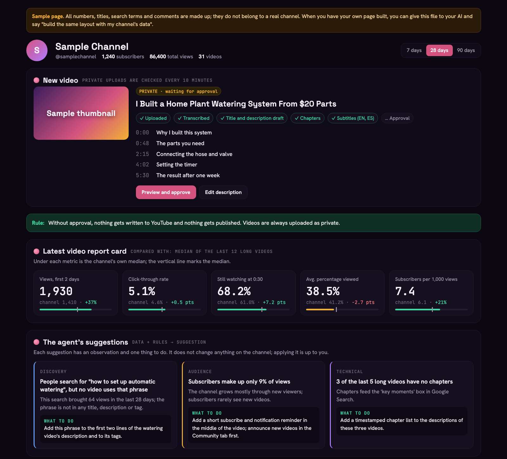

The companion page for the videos on my English YouTube channel. The guides, instructions and examples I mention with "you can find it in the description" are here. Each video has its own folder; just give a guide to your own AI (Claude, ChatGPT, etc.) and say "help me with this guide".

I show how to use AI in real life, at home and at work, in the most useful way. If you want to follow the channel:

## YouTube

[Teach Me Smart Life](https://www.youtube.com/@teachmesmartlife)

***
# YouTube API + AI: connect your channel to AI



*The sample page from the folder. All data in it is made up.*

A step-by-step guide to connecting your channel to an AI agent with YouTube's three APIs (Data, Analytics, Reporting). You can have your AI do the setup; signing in and giving permission are always up to you.

**How to use it:**
1. Open the setup guide: [guide file (README.md)](videos/youtube-api-ai/README.md)
2. Give the **whole** file to your AI. The easiest way: [open the raw version](https://raw.githubusercontent.com/berkansezer77/english-youtube-content/main/videos/youtube-api-ai/README.md), select all, copy it and paste it into the chat. Or download the file and attach it to the chat.
3. Type in the chat: *"Help me connect my YouTube channel to AI with this guide."*

The AI will walk you through it step by step. If you want a page like the one in the video, also give it the `sample-page.html` file from the folder; all of its data is made up.

[Open the folder: guide, sample page and images](videos/youtube-api-ai)

***

## Folder structure

```
videos/
└── youtube-api-ai/
    ├── README.md          guide (give it to your AI)
    ├── sample-page.html   sample channel page, all data made up
    └── images/            screenshots
```

Each new video gets its own folder under `videos/` and is added to this page with an image.

## Safety

There is no ready-made code, secret key or personal data in this repo; the guides describe everything you need, and your own AI writes the code. Do not put the `client_secret*.json` and `token*.json` files the guides create into your own copy; `.gitignore` already leaves them out.

Turkish versions of these guides: [turkish-youtube-content](https://github.com/berkansezer77/turkish-youtube-content)
