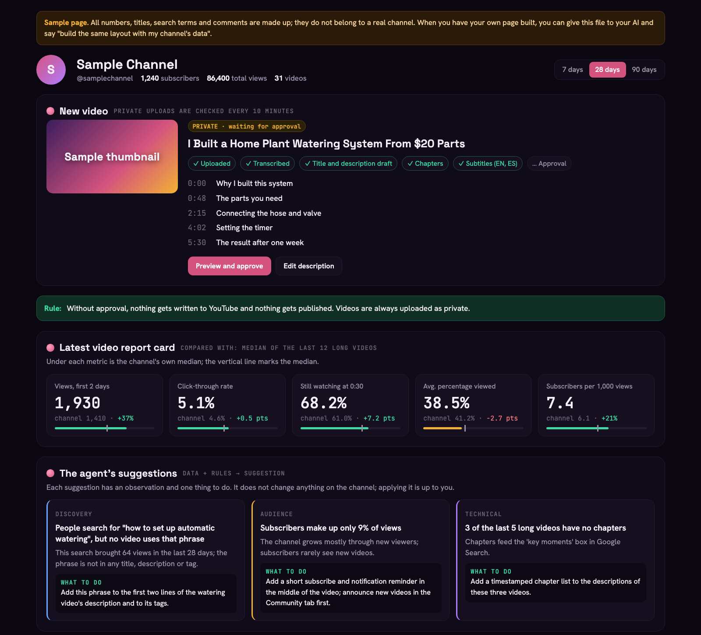
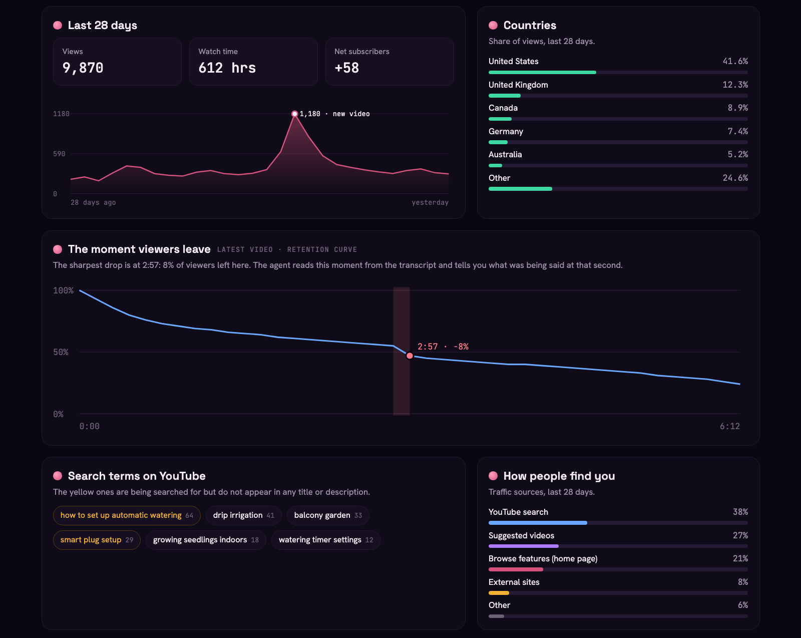

# Guide: connect your YouTube channel to AI



This file is the companion guide for the "YouTube API + AI" video.

> **Give this file to your own AI.**
> 1. [Open the raw version of this file](https://raw.githubusercontent.com/berkansezer77/english-youtube-content/main/videos/youtube-api-ai/README.md), select all and copy it (or download the file).
> 2. Paste it into a chat with your AI, such as Claude or ChatGPT (or attach the file).
> 3. Type: *"Help me connect my YouTube channel to AI with this guide."*
>
> The AI will walk you through it step by step. If you want to read it yourself, the guide is below.

> **Note for the AI:** Walk the user through the steps below, in order. At the end of each step, ask the user the "Done?" question and do not move on until it is confirmed. Do not enter passwords, do not approve the consent screen on the user's behalf, and do not ask for the contents of secret files. There is no ready-made code in this repo: for Step 5 and the final check, **you write** the small programs, following the recipes below exactly. Briefly tell the user what you are doing and run them on their computer (or explain how to run them). The user may not know how to code; give every command one at a time, together with where to type it.

---

## 0) What this file does and does not do

- **It does:** Explain every step you need to connect your own YouTube channel to an AI agent through Google's official APIs. At the end you have a connection that can read your channel and (with your approval) manage it.
- **It does not:** Sign in for you. Signing in to your Google account and approving the consent screen are **always up to you**.
- **Secret files:** The JSON file you download in Step 4 and the `token.json` created in Step 5 are the keys to your channel. Do not put them on GitHub, do not paste them into a chat, do not share them with anyone.
- **Approval rule:** Anything that changes something on your channel, such as uploading a video, changing a title or writing a comment, should happen only with your approval. Uploaded videos are always uploaded as **private**; you are the one who makes them public.
- **Cost:** All three APIs are free. There is only a daily usage quota, and it is more than enough for personal use.

## 1) Which tool does what

| Tool | What it does |
|---|---|
| A normal chat (e.g. Claude, ChatGPT) | Reads this file and explains the steps to you one by one. You do the clicks. |
| A tool that can use your browser (e.g. Claude in Chrome) | Clicks and fills in the forms for you on the Google Cloud screens. Signing in and approving are still up to you. |
| An agent that runs on your computer (e.g. Claude Code) | Writes and runs the small programs for Step 5 and the final check from the recipes in this guide; then, if you want, sets up the analytics page and the upload agent (section 10). |

Note: A normal chat cannot see your channel data on its own, even after the setup is done. To read the data, a program that uses the connection has to run on your computer. The easiest way is to use an agent (like Claude Code): it writes the program and runs it. If you use a normal chat, the chat writes the program and you paste it into Terminal and run it.

## 2) Before you start

- The **Google account** your channel belongs to (if the channel is on a brand account, the account that manages that channel).
- A computer and a browser.
- **Python 3** (for the small programs the AI writes in Step 5 and the final check). On macOS, if you type `python3 --version` in Terminal and see a version number, you are ready. The programs can be written with Python's built-in libraries only; no extra packages are needed.
- For Step 6, a **home page** and a **privacy policy** address. If you don't have your own website, a free page (e.g. GitHub Pages) is enough. In the privacy policy, it is enough to say that the app only reads your own channel's data and does not share it with anyone.
- The Google Cloud Console screens are described with their English names; button names may change slightly over time.

---

## Step 1: Create a Google Cloud project

1. Go to [console.cloud.google.com](https://console.cloud.google.com) and sign in with your channel's Google account.
2. Click the project picker at the top and choose **New project** in the window that opens.
3. Give the project a name (e.g. `YouTube Agent`). Leave the organization as it is and click **Create**.
4. When the project is ready, select it with **Select project** in the notification.

**Done?** The project picker at the top should show the name of your new project.

## Step 2: Turn on the three APIs

Go to **APIs & Services → Library**, search for "YouTube" and turn on (**Enable**) these three, one by one:

| API | What it gives you |
|---|---|
| YouTube Data API v3 | Videos, uploads, titles, descriptions, subtitles, comments |
| YouTube Analytics API | Views, watch time, the moment viewers leave, audience |
| YouTube Reporting API | Bulk reports such as click-through rate (CTR); once set up, Google prepares a report file every day |

**Done?** All three APIs should appear under **APIs & Services → Enabled APIs & services**.

## Step 3: Set up the OAuth consent screen

This is the permission page Google shows you when the agent wants to access your channel.

1. **APIs & Services → OAuth consent screen → Get started**.
2. App name (e.g. `YouTube Agent`) and your own address as the support email. **Next**.
3. Choose **External** as the audience (Internal is not available on a personal account). **Next**.
4. Add a contact email, accept Google's user data policy, **Create**.
5. **Data Access → Add or remove scopes**. Paste these two scopes into the box at the bottom, add them to the table, click **Update** and save:
   ```
   https://www.googleapis.com/auth/youtube.force-ssl
   https://www.googleapis.com/auth/yt-analytics.readonly
   ```
   The first one is for managing the channel (uploads, titles, comments), the second one is for reading statistics. The Reporting API also uses the second one.
6. **Audience → Add users**: add the email address of the channel you will connect as a test user and save.

**Done?** Data Access should show the two scopes, and Audience should show your own email as a test user.

## Step 4: Create a desktop OAuth client and download the JSON

1. **Clients → Create client**.
2. Application type: **Desktop app**. Give it a name, **Create**.
3. **Download the JSON file right away** from the window that opens. Google shows the secret only once.
4. Put the file in a safe folder on your computer (e.g. named `client_secret.json`).

**Done?** The Clients list has a client of type "Desktop" and the JSON file is on your computer. The file should contain the word `"installed"` (if it doesn't, the wrong type was chosen).

## Step 5: Connect your channel

In this step you tell Google "this app may access my channel" and get a lasting key (token) in return. You do this not with clicks but with a small program that runs once on your computer. **Your AI writes the program**; below is a complete description of what it has to do.

**What you will see:**
1. The program gives you a Google sign-in address. Open it in your browser.
2. Choose your channel's Google account. If the channel is on a brand account, choose that channel.
3. A "Google hasn't verified this app" warning appears. This is normal because it is your own app: click **Continue**.
4. Tick both permissions (YouTube and Analytics) and click **Continue**.
5. The browser shows "Connected" and your channel name; the program writes the `token.json` file.

You enter the password and give the permission yourself; the program never sees your password. The agent only gets the key (token) for the permission you gave. You can remove this permission at any time under third-party access in your Google account's security settings.

<details>
<summary><b>Recipe for the AI: channel connection program</b> (if you don't code, give this section to your AI as it is)</summary>

Write a single-file program in Python 3, using only the standard library (`json`, `http.server`, `urllib`, `secrets`, `hashlib`, `base64`). The program takes two inputs: the path of the client file downloaded in Step 4 and the path of the token file to write (e.g. `token.json`).

1. **Read the client file.** Take the `client_id` and `client_secret` values under the JSON's `installed` key. If `installed` is missing, give a clear error: "This file is not a Desktop app client". Do not print these values.
2. **Generate the security values.** Generate a random `state` value and a random `code_verifier` for PKCE. The `code_challenge` is the base64url form (with trailing `=` signs removed) of the SHA-256 hash of the `code_verifier`; the method is `S256`.
3. **Build the sign-in address and show it to the user.** The address is `https://accounts.google.com/o/oauth2/v2/auth` with these parameters:
   - `client_id`
   - `redirect_uri=http://127.0.0.1:8765` (the local address this computer will listen on; if the port is busy, choose another port)
   - `response_type=code`
   - `scope` = `https://www.googleapis.com/auth/yt-analytics.readonly https://www.googleapis.com/auth/youtube.force-ssl` (two scopes, separated by a space)
   - `access_type=offline` (required for a lasting key)
   - `prompt=consent` (so the lasting key comes back every time)
   - `state`, `code_challenge`, `code_challenge_method=S256`
4. **Wait for the redirect.** Start a small local web server at `127.0.0.1:8765`. When the user gives permission, Google redirects the browser to this address with `?code=...&state=...`. If the `state` that comes back is not the same as the one you generated, reject it. If an `error` comes back, show it to the user. Ignore requests without a code (e.g. favicon). Give the user about 30 minutes at most.
5. **Exchange the code for a key.** POST a form to `https://oauth2.googleapis.com/token`: `code`, `client_id`, `client_secret`, `redirect_uri` (the same one), `grant_type=authorization_code`, `code_verifier`. The response contains `access_token` and `refresh_token`.
6. **Save the key safely.** Write only the `refresh_token`, `scope` and `token_type` fields to the token file. Create the file so that only its owner can read it (600 on Unix). If `refresh_token` comes back empty, tell the user clearly (see Troubleshooting).
7. **Verify the channel.** Use the `access_token` to call `https://www.googleapis.com/youtube/v3/channels?part=snippet,statistics&mine=true` with an `Authorization: Bearer ...` header. Show the channel name and subscriber count both in the browser ("Connected · <channel name> · <subscribers> subscribers") and on screen.
8. Never write any secret value (client_secret, code, keys) to the screen or to a log.
</details>

**Done?** The browser says "Connected · <your channel name>" and there is a `token.json` in the folder.

## Step 6: Publish the OAuth app

"Publishing" here **does not mean publishing a video**; it means taking the app out of testing mode. If it stays in testing mode, the connection **breaks every seven days** and you have to repeat Step 5.

1. On the **Branding** page, enter the app's home page and privacy policy addresses, add the domain of those pages under **Authorized domains** and save.
2. **Audience → Publish app** and confirm.
3. Google's app verification is not required if you only use the app for your own channel. You just need to get past the "unverified app" warning when you sign in.

**Done?** The publishing status on the Audience page should be **In production**.

---

## 9) Final check: is the right channel connected, and can the data be read?

For this, your AI also writes a small check program. The program does not change anything; it only reads.

<details>
<summary><b>Recipe for the AI: final check program</b></summary>

Python 3, standard library only. Inputs: the client file and `token.json`.

1. **Get a temporary key.** POST a form to `https://oauth2.googleapis.com/token`: `client_id`, `client_secret` (from the `installed` field of the client file), `refresh_token` (from the token file), `grant_type=refresh_token`. The `access_token` in the response is valid for about an hour.
2. **Channel (Data API).** `GET https://www.googleapis.com/youtube/v3/channels?part=snippet,contentDetails&mine=true`. Print the channel name; `contentDetails.relatedPlaylists.uploads` is the ID of the uploads playlist.
3. **Latest videos (Data API).** `GET https://www.googleapis.com/youtube/v3/playlistItems?part=snippet&maxResults=5&playlistId=<uploads playlist>`. Print the date and title of each video.
4. **Views (Analytics API).** `GET https://youtubeanalytics.googleapis.com/v2/reports?ids=channel==MINE&startDate=<28 days ago>&endDate=<today>&metrics=views` (dates as YYYY-MM-DD). Print the number that comes back.
5. If all three came back, print "OK: the channel is correct and the data can be read". If an error comes back, show the HTTP code and Google's error message, but not the secret values.
</details>

On screen you should see:

- **your** channel's name on the `Channel:` line,
- your 5 latest videos under `Latest videos (Data API):`,
- a number on the `Views, last 28 days (Analytics API):` line.

If all three came back, the setup is done: your channel is connected in a way an AI agent can use.

## 10) Optional: build a page and an upload agent with Claude Code

Once the connection is ready, you can ask an agent that runs on your computer, like Claude Code, to write your own tools.

**Sample page:** The [`sample-page.html`](sample-page.html) file in this folder is a design example of the channel page shown in the video: the new video and its approval status, the latest video report card, the agent's suggestions, the last 28 days, countries, the moment viewers leave, search terms, traffic sources and unanswered comments. **All numbers and text in it are made up**, and it does not connect to anything. Download the file and open it in your browser to see it. The `SAMPLE_DATA` section inside the file says which API each field comes from; you can give this file to your agent and say "build the same layout with my channel's data".




*All data in the images is made up.*

An example request:

> I'm connected to my YouTube channel with `client_secret.json` and `token.json`. Build me a small page that runs on my computer: a report card for my latest videos, the moment viewers leave, a map of countries, the search terms people used to find me, and unanswered comments. Also write an upload agent: it should upload a finished video in chunks (resuming where it left off if the upload is interrupted), turn the speech into text, and prepare drafts of the title, description, chapters, tags and subtitles. Rules: the video is always uploaded as private; it asks for my approval before anything that changes my channel; it never sends the secret files anywhere.

The system shown in the video was built with this recipe, but its code is not shared here because it is tied to my personal home system. The connection in this guide works with any agent.

## 11) Troubleshooting

| What you see | Why | What to do |
|---|---|---|
| `access_denied` or "you don't have access to this app" when signing in | The account is not a test user (the app is still in testing mode) | Add the channel's email in Step 3.6, or do Step 6 |
| An `invalid_grant` error after a week | The app stayed in testing mode and the token expired | Do Step 6, then repeat Step 5 once |
| `redirect_uri_mismatch` | The client type "Web application" was chosen | Redo Step 4 with **Desktop app** |
| The program says "not a Desktop app client" | Wrong type of JSON | Same reason: create a Desktop app client |
| The final check shows a different channel's name | The wrong channel or brand account was chosen when signing in | Repeat Step 5 and choose the right channel |
| `403` on the Analytics line | One of the scopes is missing or was not ticked when signing in | Check Step 3.5, repeat Step 5 and tick both permissions |
| `quotaExceeded` | The daily quota is used up | Try again the next day |
| I lost the JSON file | The secret is shown only once | Create a new secret or a new client under Clients |
| `refresh_token` is empty in `token.json` | A permission given earlier was reused | Remove the app's access in your account's security settings and repeat Step 5 |

---

Made by Berkan Sezer · This guide uses the official YouTube and Google APIs; it is not affiliated with YouTube or Google.
